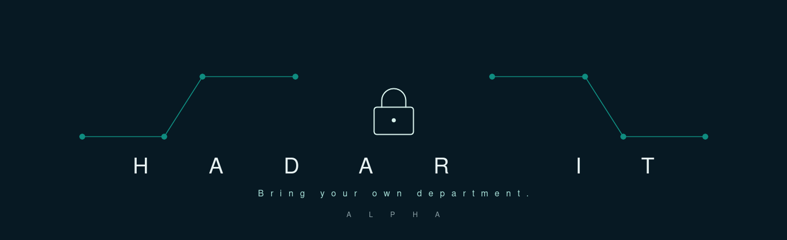

<p align="center">
  
</p>

<h1 align="center">Hadar IT</h1>

<p align="center">
  <strong>Bring your own department.</strong><br>
  An agent-first ITSM for small and mid-sized companies whose IT team is one person, or a handful.
</p>

<p align="center">
  
  
  
  
</p>

> **Alpha. Do not run this in production.** It installs, and it has been exercised in isolated development, production and demonstration setups, but nothing here is a production certification. If something breaks, [open an issue](#reporting-issues) so it gets fixed before anyone depends on it.

Hadar IT is the temporary official name. It is built to be reshaped: the data model, the views and the agent all take extensions, so the product bends toward the department instead of the other way around. It is MIT licensed, so it is entirely yours to run, change and keep.

## What is in the box

| Piece | What it is | Version |
|---|---|---|
| This repository | Compose, deployment docs, release version | `0.0.0`, unreleased |
| [`frontend/`](frontend/README.md) | React 19 and TypeScript host the shell. Vue 3 renders the domain views, from local assets, not from an iframe. | `0.1.0` |
| [`backend/`](backend/README.md) | Python API, persistence, worker, agent runtime | `0.1.0` |

The three are separate Git repositories. The root ignores `frontend/` and `backend/`, so cloning the root alone does not bring them.

- **Agent first.** With a configured model/provider, people talk to the canonical services through a built-in Pydantic AI runtime, and through operator-installed [OpenCode](https://github.com/anomalyco/opencode) and [Hermes Agent](https://github.com/NousResearch/hermes-agent) engines. [FastMCP](https://github.com/jlowin/fastmcp) exposes the same services as tools. The agent reads and writes only through those services, under the signed-in person's permissions.
- **Extension SDK.** Declarative extensions add data, pages and panels without running code in the browser. Extensions that do ship code render inside an isolated frame that never sees the session. The contract is documented in [the SDK reference](backend/itsm/extensions/sdk/references/quickstart.md).
- **One domain, three doors.** The browser, the agent and MCP share the same services and the same authorization. No door gets a private shortcut.

## What it covers today

- Identity, with Argon2id passwords and server-side sessions.
- Asset inventory, a directory of people and places, and relationships between assets.
- Redundancy groups. These describe the arrangement; they do not fail over or measure anything.
- Workflows, attachments, maintenance plans and incidents.
- Monitoring, notifications and reports.
- Workspace layout and appearance, including the visible application name.
- Search, in SQL, with optional [Meilisearch](https://github.com/meilisearch/meilisearch). Search never grants access to something the person could not already read.

Monitoring endpoints, notification destinations and model providers need configuration; queued jobs need a worker. The public demo does not provide live AI inference or an external report-job worker. Adapter tests are not live Hermes/OpenCode or Meilisearch certification. See the [functional review and limits](docs/functional-claims-validation.md).

## Working name

**Hadar IT** is the temporary official name. The string the interface shows is separate and configurable, under **Configuración → Apariencia** (`#/configuracion/apariencia`), in the field **Nombre visible de la aplicación**. The shell and the document title read it from there.

Do not rename packages, storage paths or the database to change what people see. "Asset Manager" is only the label the interface inherited, and it is not the product name.

## Run it

Docker is the supported way. `RELEASE_MODE` is mandatory: it names the Compose project and its volumes, and every process refuses to start without it. Each mode is its own project, network and volumes, so they do not share data. There is no `.env` in the repository. Export variables yourself and pass `--env-file /dev/null` so Compose never picks one up quietly.

**Development**, on one machine, with fictional data and an administrator created for you. `dev` is bound to a local SQLite file and refuses a remote database. The password below is only for that administrator; never reuse it anywhere else.

```bash
export RELEASE_MODE=dev
export ITSM_SELINUX_LEVEL=s0:c500,c501
export ITSM_DEV_ADMIN_PASSWORD='<a password for this machine only>'
docker compose --env-file /dev/null -f compose.yaml -f deploy/compose.dev.yaml up -d
```

Then open <http://127.0.0.1:18080>. The API and its OpenAPI docs are at <http://127.0.0.1:18000/docs>, and health lives at `/api/v1/health/live` and `/api/v1/health/ready`.

**Production.** The `prod` overlay migrates an empty database or runs a guarded upgrade, and it creates no accounts. It needs a reserved SELinux MCS level for the installation (`ITSM_SELINUX_LEVEL`) and the real database URL. After `initialize` finishes, create the first owner with `bootstrap-superadmin`. The password comes from the environment or from a prompt, never from the command line. The full sequence, TLS and every required variable are in [operations.md](docs/operations.md).

**Demonstration**, a public fictional installation whose documented visitor is `admin` / `admin`, reset on a timer. Publish it through the TLS profile only:

```bash
export RELEASE_MODE=demo
export ITSM_SELINUX_LEVEL=<reserved MCS level>
export ITSM_AUTH_ORIGIN=https://demo.example.com
docker compose --env-file /dev/null -f compose.yaml -f deploy/compose.demo.yaml --profile tls up -d
```

Serve a public demo over TLS only. [release-modes-deployment.md](docs/release-modes-deployment.md) explains why the three modes are separate and what each one expects.

## Verify

```bash
RELEASE_MODE=dev ITSM_SELINUX_LEVEL=s0:c500,c501 ITSM_DEV_ADMIN_PASSWORD=local-only \
  docker compose --env-file /dev/null -f compose.yaml -f deploy/compose.dev.yaml config --quiet
```

Backend and frontend test commands live in their own READMEs. What has actually been exercised, and what has not, is recorded in [pre-alpha readiness](docs/prealpha-readiness.md).

## Work in progress

None of this ships yet. It is listed so the direction is visible, not so it can be relied on.

- Fewer dependencies, and a faster backend.
- Monitoring nodes for Windows and Linux.
- A ticketing system, with a small interface on each node for writing a ticket quickly.
- Integration with [Tactical RMM](https://github.com/amidaware/tacticalrmm) and with AnyDesk.
- Integration with [Zammad](https://github.com/zammad/zammad).
- Single sign-on across several identity platforms.
- Self-development: the in-app agent writing its own extensions.
- A mobile app for notifications, alerts and a QR flow.

## Reporting issues

This is an alpha and it will misbehave. Please report it rather than working around it quietly: what you were doing, what you expected, and what happened instead. Issues are tracked per repository, so open yours against the root, [frontend](frontend/README.md) or [backend](backend/README.md) checkout that actually contains the fault.

## Documentation

| | |
|---|---|
| [operations.md](docs/operations.md) | Infrastructure, variables and the checks already run. Also in [Spanish](docs/operations.es.md). |
| [user-operations.md](docs/user-operations.md) | Installing, backing up and administering. Also in [English](docs/user-operations.en.md). |
| [user-help.md](frontend/docs/user-help.md) | Day-to-day use of inventory, incidents and reports. |
| [GLOSSARY.md](GLOSSARY.md) | Hosting and redundancy terms, and what they deliberately do not mean. |
| [design/system.md](design/system.md) | The visual system. |

## License

[MIT](LICENSE). It is entirely yours: use it, change it, ship it, sell it. Keep the copyright notice and you are fine.
