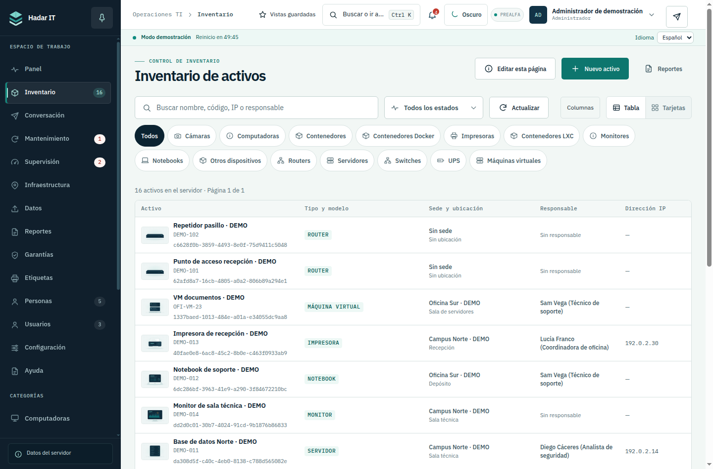

# Hadar IT

**Bring your own department.**

A small IT team should not need a dozen spreadsheets to see the whole picture.
Hadar brings your equipment, people and day-to-day work into one shared workspace.
Know what you have, who relies on it and what needs attention next.

**[Install Hadar](INSTALL.md)** · **[Explore the features](docs/features.md)** · [Technical guide](docs/technical-guide.md)

> Alpha software. Try it with demo data; it is not ready for production.

## Less chasing. More context.

- **Know your equipment.** Flexible asset records, locations, responsible people and relationships.
- **Keep work moving.** Maintenance plans, interventions, incidents and warranties alongside the asset.
- **See what needs attention.** A shared dashboard, search, monitoring and notifications.
- **Take information with you.** Imports, reports, exports, printable labels and QR codes.
- **Make it yours.** Custom fields, saved views, appearance settings and an extension SDK.
- **Ask for help.** Connect an AI assistant that works with the same inventory and permissions.

Monitoring and AI need their own configuration. Background jobs need a running worker.
The [technical guide](docs/technical-guide.md) covers the details.

## Meet your inventory

An asset is more than a row. Open its record to find its history, documents,
relationships and maintenance in one place. **[Take the screenshot tour →](docs/features.md)**

## One guide. The whole application.

The [installation guide](INSTALL.md) clones and starts all three components with Docker.
No separate Python or Node.js setup, and no need to piece together three READMEs.
Repository access is required while the project remains private.

## Built around your department

Hadar is named after a star: a reference point when there is a lot to keep track of.
You host it, choose your integrations and decide who can do what.

React and TypeScript on the frontend; Python and FastAPI on the backend.
[Architecture and configuration](docs/technical-guide.md) · [Frontend](https://github.com/MrFaviod/hadar-it-frontend) · [Backend](https://github.com/MrFaviod/hadar-it-backend)

[Report a problem](https://github.com/MrFaviod/hadar-it/issues) · [License](LICENSE)
